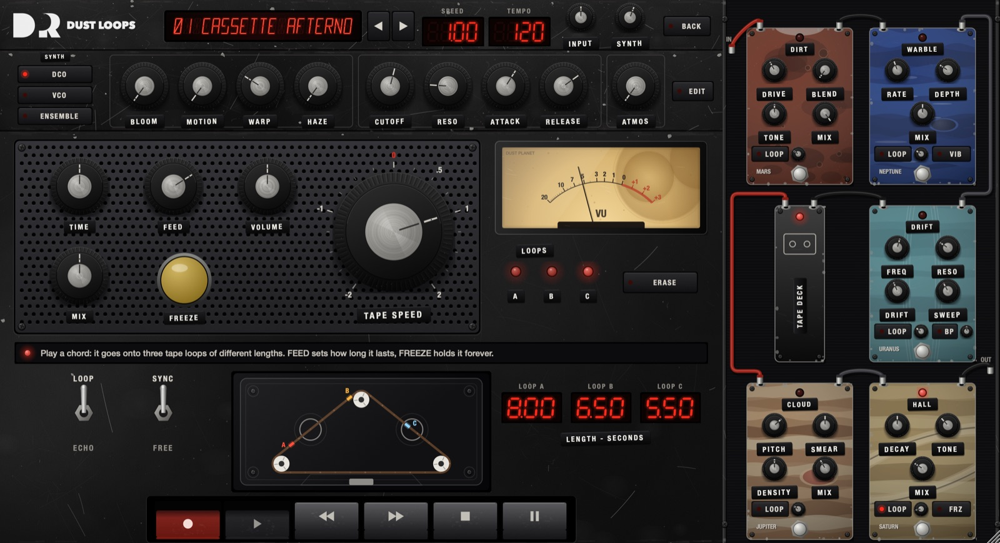
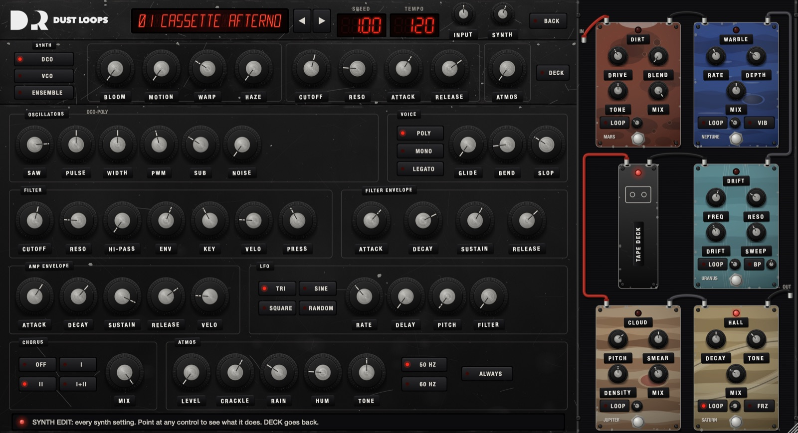
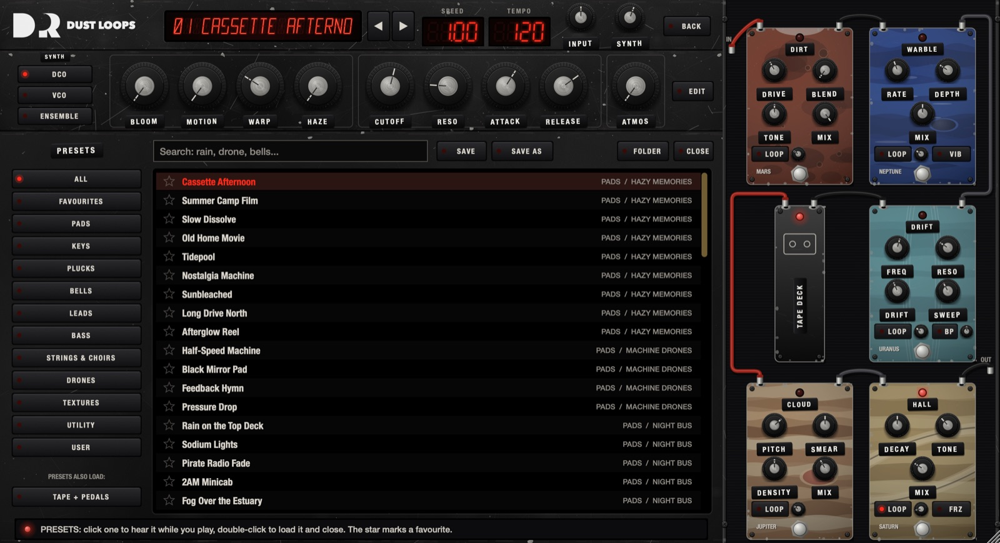

# Dust Loops

**A tape-loop drone instrument and effect for Logic Pro (Audio Unit, macOS).** It's a modded cassette deck with a synth on top and a pedalboard beside it. It's made for slowly evolving, worn, nostalgic ambient music in the spirit of Boards of Canada, Alessandro Cortini and Burial.

Play a chord. It goes onto three tape loops of different lengths, so the repeats drift in and out of phase. Each pass wears the tape a little more, and the pedals inside the loop build up over time. Turn FEED up and it becomes a drone. Hit FREEZE and it holds forever.



### What's inside
- **Synth.** Three models:
  - **DCO**: Juno-style, warm and steady, with BBD chorus.
  - **VCO**: Prophet-style, two drifting oscillators with sync and poly-mod.
  - **Ensemble**: a string machine.

  It's 8-voice (or mono/legato with glide). Four macros cover the main moves: **Bloom**, **Motion** (on the mod wheel), **Warp** and **Haze**. **Atmos** adds vinyl crackle, rain and mains hum. The essentials sit on the front panel, and everything else is on an **Edit** page.
- **Tape.**
  - **Loops:** three loops (A/B/C) in sync with Logic's tempo or in free seconds, overdub on.
  - **Echo:** an ECHO mode with three heads.
  - **Speed:** -2× to +2× with inertia and reverse, plus FREEZE and the cassette transport keys.
  - **Wear:** wow, flutter, hiss, saturation, age and dropouts, and three tape types.
  - **Cassette window:** a clear loop cassette shows each loop's position as it goes round.
- **Pedalboard.** Five pedals, each painted as a planet:
  - **Dirt** (Mars)
  - **Warble** (Neptune)
  - **Drift** filter (Uranus)
  - **Cloud** granular shimmer (Jupiter)
  - **Hall** reverb (Saturn)

  Drag them into any order, before or after the tape. Each has a **LOOP** switch that puts a copy inside the tape's feedback, so its effect grows on every pass.
- **Presets.**
  - **71 factory presets** grouped by instrument type (Pads, Keys, Plucks, Bells, Leads, Bass, Strings & Choirs, Drones, Textures, Utility), with favourites, search and your own user presets.
  - **Presets change only the synth sound**, so you can layer different sounds on one tape without touching its settings or what's armed to record.
- **Built to be safe in a session.**
  - **Real-time safe:** no allocation, locks or file I/O on the audio thread.
  - **Feedback can't run away**, and there's no NaN/inf output.
  - **Tested:** unit tests for silence, maximum feedback, random-automation fuzzing, tempo sync and every preset.

| Synth edit page | Preset browser |
|---|---|
|  |  |

It's a personal project by Dust Planet Records, built with JUCE 9 and C++20. There's no installer: you build it from source with the script below.

| Target | Format | AU type / codes | Use it on |
|---|---|---|---|
| **Dust Loops** | AU instrument + Standalone | `aumu Dlp1 Dplp` | Software instrument tracks (synth → tape → pedals; sidechain input feeds the tape) |
| **Dust Loops FX** | AU MIDI-controlled effect | `aumf Dlx1 Dplp` | Audio tracks and buses (input → tape → pedals) |

## Requirements
- Apple Silicon Mac, macOS 14 or newer. Developed on macOS 14.3.1 with Logic Pro 11.0.1.
- Xcode Command Line Tools (`xcode-select --install`), CMake 3.22 or newer, and Ninja (`brew install cmake ninja`).
- JUCE 9.0.4. `build.sh` clones it into `JUCE/` automatically if that folder is missing. It isn't committed to git.

## Build, install and validate
```bash
./build.sh
```
This does the following:
1. Configures and builds the instrument, the FX and the Standalone app (Release, Ninja) into `build/`.
2. Runs the unit tests.
3. Copies both components to `~/Library/Audio/Plug-Ins/Components` and ad-hoc signs them.
4. Restarts the AU registrar and runs `auval -strict` on both AUs.

The script stops on the first failure. The full auval logs are in `build/auval-*.log`.

Variations:
```bash
SKIP_AUVAL=1 ./build.sh       # quicker iteration
CONFIG=Debug ./build.sh       # debug build in build-debug/
open "build/DustLoops_artefacts/Release/Standalone/Dust Loops.app"
```

If Logic doesn't show a new build: quit Logic, run `./build.sh`, and reopen Logic. If it still doesn't appear, go to **Logic Pro → Settings → Plug-in Manager**, select the Dust Loops entries and click **Reset & Rescan Selection**.

## How to play it
The plugin is laid out wide: the synth strip and the cassette deck on the left, the pedalboard on the right. Hover over any control and the hint strip tells you what it does.

**Presets first.** The red display at the top shows the current preset. Click ◀ ▶ to step through presets, or click the display to open the browser:
- instrument types on the left: Pads, Keys, Plucks, Bells, Leads, Bass, Strings & Choirs, Drones, Textures, Utility, plus All, Favourites and User
- each preset also has a mood (Hazy Memories, Machine Drones, Night Bus), shown on the right and searchable
- a search box: try "rain", "drone" or "bells"
- one click loads a preset so you can audition it while you play, and a double-click loads it and closes the browser
- the star marks a favourite
- **SAVE** / **SAVE AS** store your own presets in `~/Music/Dust Loops/Presets` (the User bank), and **FOLDER** opens that folder
- a `*` after the name means you've changed the sound since loading it
- **Presets only change the synth sound.** The tape, the loops, REC and the pedals stay exactly as they are, so you can play one sound onto the tape, switch presets, and layer another on top. Nothing records unless you've armed it. If you want a preset's own tape and pedal settings too, light **TAPE + PEDALS** in the browser (it's remembered). Even then REC is never changed. In the FX version presets always set the tape and pedals, because there's no synth.

Logic's own preset menu (top of the plugin window) also lists the factory presets.

**The synth strip** (instrument only):
- **DCO / VCO / ENSEMBLE** pick the synth: a warm Juno-style DCO, two drifting Prophet-style VCOs, or an old string machine.
- **BLOOM** makes notes swell in and fade out long. **MOTION** adds vibrato and a breathing filter (the mod wheel turns it up too). **WARP** detunes and wobbles the pitch. **HAZE** makes it darker, softer and further away.
- **CUTOFF**, **RESO**, **ATTACK** and **RELEASE** are the basics. **ATMOS** adds vinyl crackle, rain and hum.
- **EDIT** opens the full synth page (oscillators, voice mode and glide, filter and its envelope, amp envelope, LFO, chorus, Atmos). Click **DECK** to go back.
- Velocity and aftertouch open the filter. The sustain pedal works. The mod wheel drives MOTION.

**The deck:**

1. **Play a chord.** Everything you play goes onto three tape loops (A, B and C) of different lengths, so the repeats drift against each other. In the cassette window, the markers A, B and C each go round once per pass of their own loop.
2. **FEED** sets how long it lasts. Low: each repeat fades quickly. High: layers pile up into a drone.
3. **FREEZE** (the yellow button) holds what's on the tape forever. Nothing new goes on and nothing fades. Play over the top of it.
4. **TAPE SPEED** (the big knob) slows the tape down, speeds it up or runs it backwards, and the pitch follows. It clicks in at 1x, 0.5x and -1x. Double-click any knob to reset it.
5. **TIME** stretches the loops in LOOP mode, or sets the echo time in ECHO mode. **MIX** sets dry sound against tape, and **VOLUME** sets the tape level.
6. **Piano keys:**
   - ● arms or disarms recording (the A/B/C lights)
   - ▶ plays
   - hold ◀◀ for reverse
   - hold ▶▶ for double speed
   - ■ brakes the tape to a stop
   - ❚❚ is a quick stop and restart
7. **A / B / C lights:** click one to arm or disarm that loop. **ERASE** wipes all three.
8. **LOOP / ECHO switch:** tape loops that wear out with every pass, or a tape echo with three heads. **SYNC / FREE switch:** loop lengths in beats that follow Logic's tempo, or in seconds.
9. **BACK** opens the back panel, which holds the less-used settings:
   - per-loop length, level, pan, speed, mute and clear
   - tape type, wow, flutter, hiss, saturation, age and dropouts
   - inertia, brake time and master level

10. **Pedals** (to the right of the deck), each painted as a planet: DIRT is Mars, WARBLE Neptune, DRIFT Uranus, CLOUD Jupiter and HALL Saturn. Stomp the footswitch to turn a pedal on.
    - **LOOP** puts a copy of the pedal inside the tape loop, so its effect builds up on every pass. That's where the drones come from. The little trim next to it sets how much.
    - The signal snakes through the board: left to right along the top row, right to left along the middle row, left to right along the bottom row, from IN to OUT. The cables show the route.
    - Drag a pedal by its body to any spot to move it. Pedals before the **TAPE DECK** block go onto the tape; pedals after it colour what comes off it.

The window is 1384 × 752 at 100 %, sized to fit a 13" MacBook screen. You can resize it from 75 % to 200 % by dragging its corner, and it remembers its size. It never opens bigger than the screen.

## Using it in Logic

### Instrument
Create a Software Instrument track, then **Instrument slot → AU Instruments → Dust Planet Records → Dust Loops**.

### Feeding another track into the tape (sidechain)
1. Put Dust Loops on a Software Instrument track.
2. In the plugin window's header bar, open the **Side Chain** menu and choose the track or bus you want to record. For example, a guitar track or a bus with your drums.
3. That audio now goes into Dust Loops on top of the synth, through the pre-tape pedals and onto the tape. **Input Gain** sets its level.

The source track still plays through its own channel as normal. Turn it down or mute its output if you only want to hear it through the tape.

### Effect
On an audio track or bus: **Audio FX slot → Audio Units → Dust Planet Records → Dust Loops FX**.

Dust Loops FX is a *MIDI-controlled effect*. To control REC arm, FREEZE and so on from a MIDI keyboard, pick the keyboard's track in the plugin header's **Side Chain** menu. In Logic, that menu also lists MIDI sources for MIDI-controlled effects.

## Project layout
```
CMakeLists.txt      targets, plus the identity block at the top (name, codes, bundle ID)
build.sh            build → test → install → sign → auval
Source/Core/        Identity.h (product name constant), Params.{h,cpp} (every parameter ID)
Source/DSP/         allocation-free DSP building blocks (Safety.h: NaN scrub, limiters)
Source/Tape/        TapeMachine.h: the three loops / echo, wear, varispeed, transport
Source/Pedals/      Pedals.h: Dirt, Warble, DriftFilter, Cloud, Hall + the PedalBoard (main + in-loop copies)
Source/Gui/         the deck: parts (knobs, keys, cassette...), front/back panels, pedalboard
Source/Synth/       SynthEngine.h (voices, models, macros, MIDI), BlepOsc.h, Chorus.h (Juno BBD + ensemble), Atmos.h
Source/Presets/     PresetManager: factory + user presets, favourites, search, Logic's preset menu
Source/Plugin/      processor + editor (one class serves both plugins; DUST_LOOPS_FX switches the synth out)
tests/              unit tests (run by build.sh, or: build/DustLoopsTests_artefacts/Release/DustLoopsTests)
assets/             Dust Planet Records logo
docs/images/        README screenshots (rendered with DustSnapshot)
tools/              Snapshot.cpp renders the UI to PNG (cmake --build build --target DustSnapshot, or DustSnapshotFX)
                    Render.cpp renders every preset and reports levels (cmake --build build --target DustRender)
                    make_presets.py wrote the starting set of factory presets
presets/            factory presets as JSON, one folder per instrument type; built into the plugin
```

## Recording the output in Logic
A plugin can't write audio onto Logic's tracks itself. To capture a performance, including knob moves and the tape:
- **Bounce in Place:** right-click the region and choose Bounce and Replace, or Bounce in Place.
- **Live:** set the Dust Loops channel's output to a bus. Create an audio track with that bus as its input, record-arm it and record while you play.

## Presets as files
A preset is a JSON file:
```json
{ "name": "Cassette Afternoon", "category": "Pads", "mood": "Hazy Memories", "description": "...",
  "pedalOrder": "dirt,warble,drift,tape,cloud,hall",
  "params": { "synth.model": "DCO-Poly", "synth.cutoff": 1500, "pedal.hall.on": true } }
```
Values are in real units (Hz, seconds, dB), and choices are given by name. Anything left out loads at its default. Transport keys, REC arms, CLEAR, FREEZE and INPUT are never stored, so loading a preset never arms, stops or wipes the tape. Normally only the `synth.*` and `atmos.*` values are loaded; the rest are used only with TAPE + PEDALS on. To change a factory preset, edit its file in `presets/` and rebuild. Your own presets in `~/Music/Dust Loops/Presets` can be edited the same way.

Loudness: `DustRender --trims tools/preset_trims.json` measures each preset and updates the trims. `python3 tools/make_presets.py` then rewrites the JSON with the trims applied to `synth.level`, targeting about -18 dBFS (measured sound-only, on the default tape and pedals).

## Renaming
Change `DL_PRODUCT_NAME` (and the codes and bundle ID, if you like) at the top of `CMakeLists.txt`, then delete `build/` and run `./build.sh`. Saved projects keep working, because the internal state ID doesn't depend on the name. If you change the codes, though, Logic will see it as a new plugin.

## Parameter IDs
Every parameter ID is sectioned (`synth.cutoff`, `tape.feed`, `loopB.level`, `pedal.hall.mix`, ...) and versioned. IDs are never renamed or reused once they ship, so Logic automation and saved projects stay valid.
